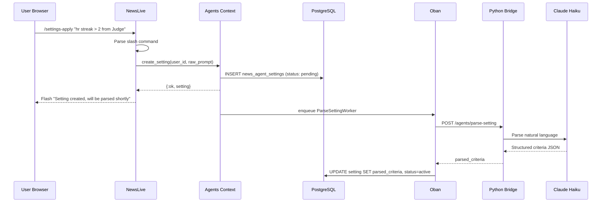
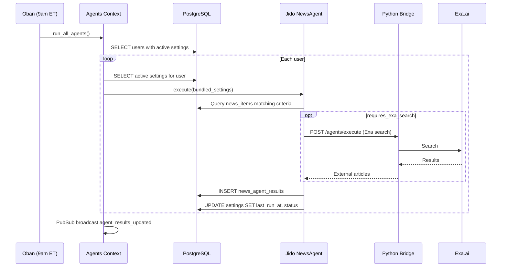

# Specification: Agentic News Feed with Command Input & Skills Architecture

## Summary

Add an LLM-powered agent system to the MLB news feed that lets users define natural language "settings" (agent tasks) via a sticky command input box. Settings are parsed by an LLM into structured search/filter criteria, executed daily at 9am ET via Oban, and displayed in a new Agents tab alongside the existing news feed. The system uses the Jido agent framework for skills-based orchestration with future MCP and multi-channel extensibility. Additionally, unhide the already-resolved player and team entity data in the news feed display.

## Requirements

### Functional Requirements

1. **FR-001** Sticky Command Input: Add a 4-line `<textarea>` at the top of `NewsLive` that remains fixed at the top of the viewport on scroll (`sticky top-0 z-10`). Visible on `/mlb/news`, `/mlb/news/:date`, and the home route `/`. Requires user authentication -- unauthenticated users see a disabled input with a "Log in to use agent commands" placeholder.

2. **FR-002** Slash Command Parsing: The input box processes three command types on submit (Enter or button):
   - `/settings-apply "<natural language description>"` -- creates or updates an agent setting
   - `/settings-clear` -- removes all active settings for the current user
   - Any text without a slash prefix -- treated as a natural language search against the current feed (client-side filter in Phase 1, LLM-powered in Phase 2)

3. **FR-003** Settings Persistence: Each user setting is stored in PostgreSQL (`accounts.news_agent_settings` table) with: user_id, raw_prompt (the original natural language), parsed_criteria (JSONB -- LLM-structured output), status (pending/running/completed/failed/expired), last_run_at, last_result (JSONB), created_at.

4. **FR-004** LLM-Powered Prompt Parsing: When `/settings-apply` is submitted, the system calls the Python Bridge with a new `/agents/parse-setting` endpoint that uses Claude to decompose the natural language into structured criteria. The LLM output includes: target_players (list of player names), target_teams (list of team names), target_leagues (AL/NL/both), stat_filters (e.g., `{type: "hr_streak", min: 2}`), categories (list of news categories to match), domain_tags (baseball-specific concepts like "trade deadline", "streak", "walk-off"), requires_exa_search (boolean -- whether external search is needed), exa_query (pre-formulated Exa search string if needed).

5. **FR-005** Agent Execution: A new Oban worker `RunNewsAgentsWorker` executes daily at 9am ET (13:00 UTC during EDT, 14:00 UTC during EST). For each user with active settings:
   - Bundle all settings into a single agent prompt
   - Execute tool calls (0 to N, depending on complexity): database queries, Exa searches, classification checks
   - Store results in `news_agent_results` with references to matched news_item IDs
   - Update each setting's status and last_run_at

6. **FR-006** Agents Tab: Add a second tab to `NewsLive` (tabs: "Feed" | "Agents") showing:
   - List of active agent settings with their raw prompt and status
   - Results from the last run, grouped by setting
   - Each result links to the corresponding news article
   - Delete button per setting
   - "Run Now" button (enqueues immediate execution, admin/premium only)

7. **FR-007** Display Entity Data: Unhide the player and team associations already present in the feed data. Each news article card shows:
   - Player names as clickable links to `/mlb/players/:team/:player`
   - Team names as clickable links to `/mlb/teams/:team` with team abbreviation badges
   - League badge (AL/NL) derived from team.league

8. **FR-008** Enhanced News Classification: Extend the Python Bridge `/news/analyze` endpoint to also return:
   - `domain_tags`: list of baseball-domain tags (e.g., "streak", "home-run", "trade-deadline", "walk-off", "no-hitter", "save", "closer", "bullpen", "rotation", "prospect", "call-up", "slump")
   - These are stored as a new `domain_tags` text array column on `content.news_items`

9. **FR-009** Joshua Admin Configuration: Add an "Agents" section to the Joshua admin panel with:
   - Toggle to enable/disable agent execution globally (feature flag: `news_agents_enabled`)
   - Cron schedule override (default: `0 13 * * *` for 9am ET)
   - View of all users' active settings (read-only)
   - Manual "Run All Agents" trigger button

10. **FR-010** Natural Language Search (Phase 1): When no slash command prefix is detected, filter the current `@feed` list client-side by matching the search text against article titles, ai_summary, player names, and team names (case-insensitive substring match). Display filtered results in real-time as the user types (debounced 300ms via `phx-debounce`).

### Non-Functional Requirements

1. **NFR-001** Performance: The command input submission must respond (acknowledge) within 500ms. LLM parsing happens asynchronously -- the setting is created immediately with status "pending" and parsed in background.
2. **NFR-002** Performance: Agent execution for a single user with up to 10 settings must complete within 60 seconds. Users with more than 10 active settings are rate-limited.
3. **NFR-003** Security: Settings are user-scoped. Users can only view/modify/delete their own settings. The LLM prompt for parsing settings must include guardrails against prompt injection.
4. **NFR-004** Security: The `/agents/parse-setting` Python Bridge endpoint must sanitize input and reject prompts over 500 characters.
5. **NFR-005** Reliability: If agent execution fails for one user, it must not block execution for other users. Each user's agent run is independent.
6. **NFR-006** Reliability: If the Python Bridge is unavailable (circuit breaker open), settings are created with status "pending" and parsed on the next successful health check cycle.
7. **NFR-007** Scalability: Phase 1 processes users sequentially. Future Phase 2 batches all users' settings together for efficient LLM calls (noted in FR-005 as future work).

## Architecture

### System Design

```mermaid
graph TB
    subgraph Browser
        NL[NewsLive]
        CI[Command Input Box]
        FT[Feed Tab]
        AT[Agents Tab]
    end

    subgraph Phoenix
        NL --> CI
        NL --> FT
        NL --> AT
        CI -->|submit| HE[handle_event]
        HE -->|/settings-apply| AC[Agents Context]
        HE -->|/settings-clear| AC
        HE -->|plain text| SF[Search/Filter]
        AC -->|create setting| DB[(PostgreSQL)]
        AC -->|parse async| PB[Python Bridge]
    end

    subgraph Oban
        RNW[RunNewsAgentsWorker<br/>9am ET daily]
        RNW --> AC
        RNW --> PB
        RNW --> DB
    end

    subgraph PythonBridge[Python Bridge - FastAPI]
        PS[/agents/parse-setting]
        AE[/agents/execute]
        NA[/news/analyze<br/>+domain_tags]
        PS --> Claude[Claude Haiku]
        AE --> Claude
        AE --> Exa[Exa.ai Search]
    end

    subgraph JidoFramework[Jido Agent Framework]
        JA[NewsAgent]
        SK1[ParseSettingSkill]
        SK2[SearchNewsSkill]
        SK3[ExaSearchSkill]
        SK4[ClassifyFilterSkill]
        JA --> SK1
        JA --> SK2
        JA --> SK3
        JA --> SK4
    end

    subgraph Admin[Joshua Admin]
        AF[Agents Config Tab]
        AF -->|feature flag| FF[FeatureFlags]
        AF -->|manual trigger| RNW
    end
```

### Data Flow: Setting Creation



### Data Flow: Agent Execution



### API Design

#### Python Bridge Endpoints (new)

**POST /agents/parse-setting**

Request:
```json
{
  "raw_prompt": "more than 2 hr streak from Bryce Harper or Aaron Judge",
  "context": {
    "available_teams": ["New York Yankees", "Philadelphia Phillies", ...],
    "available_categories": ["injury_new", "performance", "trade", ...]
  }
}
```

Response:
```json
{
  "target_players": ["Bryce Harper", "Aaron Judge"],
  "target_teams": [],
  "target_leagues": ["both"],
  "stat_filters": [{"type": "hr_streak", "operator": "gt", "value": 2}],
  "categories": ["performance"],
  "domain_tags": ["home-run", "streak"],
  "requires_exa_search": false,
  "exa_query": null,
  "confidence": 0.92,
  "interpretation": "Track news about Bryce Harper or Aaron Judge with home run streaks exceeding 2 games"
}
```

**POST /agents/execute**

Request:
```json
{
  "settings": [
    {
      "id": "uuid",
      "parsed_criteria": { ... },
      "raw_prompt": "..."
    }
  ],
  "date_range": {
    "from": "2026-05-14",
    "to": "2026-05-15"
  }
}
```

Response:
```json
{
  "results": [
    {
      "setting_id": "uuid",
      "matched_articles": ["news_item_id_1", "news_item_id_2"],
      "exa_articles": [
        {"title": "...", "url": "...", "summary": "...", "published": "..."}
      ],
      "explanation": "Found 2 articles matching your criteria about Judge's 5-game HR streak"
    }
  ]
}
```

#### LiveView Events (new)

| Event | Payload | Handler |
|-------|---------|---------|
| `submit_command` | `%{"input" => text}` | Parse command, dispatch to appropriate handler |
| `delete_setting` | `%{"id" => setting_id}` | Delete user's setting |
| `switch_news_tab` | `%{"tab" => "feed" \| "agents"}` | Toggle tab view |
| `search_feed` | `%{"query" => text}` | Client-side filter on feed |
| `run_setting_now` | `%{"id" => setting_id}` | Enqueue immediate execution (premium) |

## Database Changes

### New Table: `accounts.news_agent_settings`

```sql
CREATE TABLE accounts.news_agent_settings (
  id UUID PRIMARY KEY DEFAULT gen_random_uuid(),
  user_id UUID NOT NULL REFERENCES accounts.users(id) ON DELETE CASCADE,
  raw_prompt TEXT NOT NULL,
  parsed_criteria JSONB,
  status VARCHAR(20) NOT NULL DEFAULT 'pending'
    CHECK (status IN ('pending', 'active', 'running', 'completed', 'failed', 'expired')),
  last_run_at TIMESTAMP WITH TIME ZONE,
  last_result JSONB,
  error_message TEXT,
  created_at TIMESTAMP WITH TIME ZONE NOT NULL DEFAULT NOW(),
  updated_at TIMESTAMP WITH TIME ZONE NOT NULL DEFAULT NOW()
);

CREATE INDEX idx_news_agent_settings_user_id ON accounts.news_agent_settings(user_id);
CREATE INDEX idx_news_agent_settings_status ON accounts.news_agent_settings(status);
```

### New Table: `accounts.news_agent_results`

```sql
CREATE TABLE accounts.news_agent_results (
  id UUID PRIMARY KEY DEFAULT gen_random_uuid(),
  user_id UUID NOT NULL REFERENCES accounts.users(id) ON DELETE CASCADE,
  setting_id UUID NOT NULL REFERENCES accounts.news_agent_settings(id) ON DELETE CASCADE,
  matched_news_item_ids UUID[] DEFAULT '{}',
  exa_results JSONB DEFAULT '[]',
  explanation TEXT,
  run_date DATE NOT NULL,
  created_at TIMESTAMP WITH TIME ZONE NOT NULL DEFAULT NOW()
);

CREATE INDEX idx_news_agent_results_user_setting
  ON accounts.news_agent_results(user_id, setting_id);
CREATE INDEX idx_news_agent_results_run_date
  ON accounts.news_agent_results(run_date);
```

### Alter Table: `content.news_items`

```sql
ALTER TABLE content.news_items ADD COLUMN domain_tags TEXT[] DEFAULT '{}';
CREATE INDEX idx_news_items_domain_tags ON content.news_items USING GIN(domain_tags);
```

## Security Considerations

- **Prompt injection mitigation**: The system prompt for `/agents/parse-setting` must include explicit instructions to ignore any instructions embedded in user input. The `raw_prompt` is treated as opaque data, never interpolated into executable prompts without sandboxing. Max prompt length: 500 characters.
- **User isolation**: All agent settings and results are strictly scoped to `user_id`. Context queries include `WHERE user_id = $1` unconditionally. No admin can modify user settings (read-only in Joshua).
- **Rate limiting**: Max 20 active settings per user. Max 5 `/settings-apply` commands per user per hour. Enforced at the context layer.
- **LLM cost control**: Each setting parse costs one Claude Haiku call (~$0.001). Daily execution costs 1 call per user batch. At 100 users with 10 settings each, daily cost is approximately $0.10 for parsing + $1.00 for execution. Circuit breaker protects against runaway calls.
- **Input sanitization**: `raw_prompt` is HTML-escaped before display. `parsed_criteria` JSONB is never rendered as raw HTML. Exa results (external content) must be sanitized with `HtmlSanitizeEx` before display (SEC-001 applies here too).
- **Authentication required**: Command input is gated on `@current_user`. Unauthenticated users see a disabled input. All agent-related LiveView events verify `socket.assigns.current_user` before processing.

## Technology Decisions

| Decision | Choice | Rationale |
|----------|--------|-----------|
| Agent Framework | Jido ~> 2.2 | Elixir-native agent framework with skills composition, future MCP support, and OpenClaw community compatibility. Avoids building custom orchestration. |
| LLM for parsing | Claude Haiku via Python Bridge | Consistent with existing news classification pipeline. Haiku is cost-effective for structured extraction. |
| Settings storage | PostgreSQL JSONB | Flexible schema for parsed criteria that may evolve. Supports GIN indexing for future querying. |
| Daily execution | Oban cron worker | Consistent with existing worker pattern. Configurable schedule via feature flags. |
| Search (Phase 1) | Client-side filter | Simplest implementation. The feed data is already in LiveView assigns. Phase 2 moves to server-side LLM search. |
| Tab UI | LiveView assigns toggle | No URL change needed. Tabs are ephemeral UI state, not bookmarkable routes. |
| Domain tags | Text array on news_items | Simple, GIN-indexable, compatible with existing schema patterns (player_ids, team_ids are arrays). |

### ADR-001: Jido Agent Framework Adoption

**Status**: Proposed
**Context**: The system needs an agent orchestration layer for composing LLM calls, tool use, and multi-step workflows. Building custom orchestration would duplicate patterns that Jido already provides. The user explicitly requested Jido for OpenClaw compatibility and future MCP integration.
**Decision**: Add `{:jido, "~> 2.2"}` to mix.exs. Define a `SportsFanatic.Agents.NewsAgent` using Jido's agent API with skills for parsing, searching, and filtering. The agent wraps existing Python Bridge calls and database queries.
**Consequences**: Adds a new dependency with its own supervision tree. Team must learn Jido's skills/agent API. Benefits: standardized agent patterns, future MCP server support, community skill sharing via OpenClaw. Risk: Jido is a relatively young framework (v2.2) -- pin the version and vendor the docs.

### ADR-002: Async Setting Parsing

**Status**: Proposed
**Context**: Parsing a natural language setting requires an LLM call (200-2000ms). Blocking the LiveView event handler would degrade UX.
**Decision**: Create the setting immediately with status "pending", enqueue a `ParseSettingWorker` Oban job, and update the setting asynchronously. The LiveView subscribes to PubSub topic `agent:settings:#{user_id}` to receive real-time status updates.
**Consequences**: Slightly more complex flow but responsive UX. The user sees their setting immediately with a "Parsing..." badge. If parsing fails, the setting shows "failed" status with an error message. The user can delete and retry.

### ADR-003: Single Daily Execution vs Real-Time

**Status**: Proposed
**Context**: The user explicitly stated agents run once daily at 9am ET, not every 15 minutes. Future optimization will batch users together.
**Decision**: Use `RunNewsAgentsWorker` with Oban cron `0 13 * * *` (9am ET = 13:00 UTC during EDT). Each user is processed sequentially in Phase 1. The schedule is stored as a feature flag value so Joshua admin can modify it.
**Consequences**: Results are stale by end of day. Users who create settings after 9am won't see results until the next morning. Premium users get a "Run Now" button for immediate execution. Future batching optimization is a separate feature.

### ADR-004: Command Input on Public Page with Auth Gate

**Status**: Proposed
**Context**: The news page is public (SEO-indexed). Adding interactive agent features requires authentication but must not break the public page.
**Decision**: The command input textarea is always rendered but disabled for unauthenticated users with a placeholder directing them to log in. All `handle_event` callbacks for agent commands check `socket.assigns.current_user` and return a flash error if nil. This preserves the public page's SEO properties while adding interactive features for logged-in users.
**Consequences**: The textarea adds minimal HTML weight to the public page. It does not affect SEO (no content shift, no JS dependency for rendering). The sticky positioning uses CSS only. LiveView JS hooks are not needed for Phase 1.

## Constraints

- Phoenix LiveView 0.19 -- no LiveView 1.0 features (streams, async_result). Use `phx-update="replace"` for feed updates.
- The existing `NewsLive` must continue to work identically for unauthenticated users -- no regressions in news feed rendering, PubSub updates, or date navigation.
- Jido 2.2 must be compatible with OTP 26 and Elixir 1.14+ (the project's minimum versions).
- The Python Bridge `/agents/*` endpoints must use the same Claude Haiku model as `/news/analyze` for cost consistency.
- Agent execution schedule is UTC-based in Oban cron but must account for ET daylight saving transitions. Use `America/New_York` timezone conversion when displaying "next run" time in the UI.
- Maximum 500-character raw prompt length to prevent LLM token abuse.
- No WebSocket-based real-time agent execution -- agents run in Oban workers, not in the LiveView process.

## Implementation Phases

### Phase 1 (This PR)
- Sticky command input box on NewsLive
- `/settings-apply` and `/settings-clear` commands
- Settings persistence (PostgreSQL)
- LLM parsing via Python Bridge
- Agents tab showing settings and status
- Unhide player/team data in news cards
- `domain_tags` column on news_items
- Enhanced `/news/analyze` with domain_tags
- Joshua admin: feature flag + manual trigger
- Client-side natural language search

### Phase 2 (Future)
- Jido agent framework integration with skills
- Batched multi-user execution
- MCP server for external tool integration
- OpenClaw community skill sharing
- Server-side LLM-powered search
- Multi-channel support (beyond browser)
- Exa.ai deep search integration in agent execution

### Phase 3 (Future)
- Per-user agent execution frequency configuration
- Agent result notifications (email, push)
- Agent result caching in Valkey
- Historical agent result browsing
- Shared/public agent settings ("follow this agent")

## Out of Scope

- Real-time agent execution (agents do NOT run on every news fetch; they run on schedule)
- User-to-user setting sharing
- Payment/billing changes for agent features (all authenticated users get agents in Phase 1)
- Mobile app or native client support
- Agent result export (CSV, API)
- Custom cron schedules per user (admin-only global schedule)
- Exa.ai integration in Phase 1 (parsed_criteria can flag `requires_exa_search` but execution defers to Phase 2)
- MCP server implementation (Phase 2)
- OpenClaw skill publishing (Phase 2)

## Open Questions

- **Q1**: Should natural language search (no slash prefix) also create a persistent setting, or is it ephemeral (filter-and-forget)? -- Suggested answer: Ephemeral in Phase 1. Users who want persistence use `/settings-apply`.
- **Q2**: Should agent results include a relevance score? -- Suggested answer: Yes, the LLM execution response should include a confidence/relevance score (0.0-1.0) per matched article, used for sorting results in the Agents tab.
- **Q3**: Should the "Run Now" button be available to all authenticated users or only premium subscribers? -- Suggested answer: Premium subscribers only, to incentivize upgrades and limit LLM costs. Free users wait for the daily 9am run.
- **Q4**: How should domain_tags be populated for existing news_items that were classified before domain_tags was added? -- Suggested answer: Add a backfill Oban worker that re-classifies articles missing domain_tags. Run it once after deployment, then disable.
- **Q5**: Should the command input support multi-line prompts or should Enter submit? -- Suggested answer: Enter submits. Shift+Enter for newline. This matches chat input conventions. The 4-line height accommodates longer prompts that wrap but does not require explicit newlines.

## File Changes Summary

### New Files
- `lib/sports_fanatic/agents.ex` -- Agents context (CRUD for settings/results, execution orchestration)
- `lib/sports_fanatic/agents/news_agent_setting.ex` -- Ecto schema
- `lib/sports_fanatic/agents/news_agent_result.ex` -- Ecto schema
- `lib/sports_fanatic/workers/run_news_agents_worker.ex` -- Daily Oban worker
- `lib/sports_fanatic/workers/parse_setting_worker.ex` -- Async LLM parsing worker
- `python_bridge/src/api/agents.py` -- FastAPI router for `/agents/*`
- `python_bridge/src/agents/parser.py` -- Setting parsing with Claude
- `priv/repo/migrations/TIMESTAMP_create_news_agent_tables.exs` -- Migration

### Modified Files
- `mix.exs` -- Add `{:jido, "~> 2.2"}` dependency (Phase 2 activation)
- `lib/sports_fanatic_web/live/news_live.ex` -- Add command input handling, tabs, search, entity display
- `lib/sports_fanatic_web/live/news_live.html.heex` -- Template changes for input, tabs, entity badges
- `lib/sports_fanatic/content/news_item.ex` -- Add `domain_tags` field
- `lib/sports_fanatic/python_bridge.ex` -- Add `parse_setting/2` and `execute_agents/2` functions
- `python_bridge/src/news/analyzer.py` -- Add domain_tags to CLASSIFY_TOOL schema
- `python_bridge/src/news/models.py` -- Add domain_tags to Pydantic model
- `python_bridge/src/main.py` -- Register agents router
- `lib/sports_fanatic_web/live/admin_live.ex` -- Add Agents config tab
- `config/config.exs` -- Add RunNewsAgentsWorker to Oban crontab
