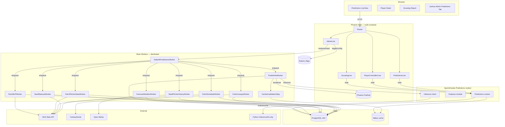
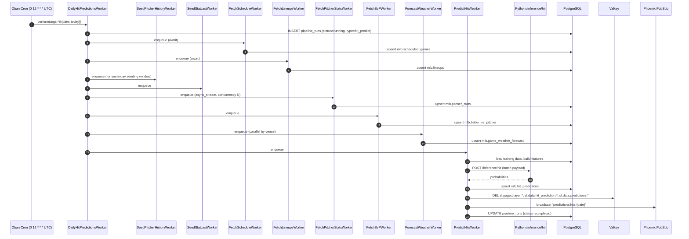

# Specification: Elixir-Native Hit Predictions Pipeline

**Agent**: architect
**Session**: 20260517_111655_elixir-hit-predictions-pipeline
**Date**: 2026-05-17
**Reference**: `/Users/charmalloc/dev/sports-fan-agent/` (Python implementation)
**Target**: `/Users/charmalloc/dev/sports-fanatic/` (Elixir/Phoenix application)

---

## Summary

Port the hit-prediction feature from the Python `sports-fan-agent` reference into Elixir/Phoenix. The pipeline runs daily at 8:00 AM ET, seeds hitter and pitcher data fresh on every run, generates per-player hit probabilities for all today's lineup players, persists them in a new `mlb.hit_predictions` table for long-term analytics, and surfaces them in (1) a renamed top-level `/predictions` page sorted by hit % desc, (2) a richer scouting report page that shows today's hit % + matchup + game time prominently at the top, and (3) a new Joshua admin "Predictions" tab. The pipeline runs in pure Elixir using Oban for distributed work and `Task.async_stream` with runtime-configurable concurrency. The Python Bridge surface area is narrowed: legacy `/predict/hit`, `/predict/hr`, `/schedule/*`, `/simulation/*`, `/scouting/search_multi`, `/scouting/classify`, and `/agents/execute` are deleted. The Python service remains only for Claude-driven content (news classify, scouting prose generation, game day, agent setting parsing, chat synthesis).

---

## Requirements

### Functional Requirements

1. **FR-001** Daily orchestrator runs at 8:00 AM ET (`0 12 * * *` UTC during EDT, configurable via `PREDICTIONS_CRON_OVERRIDE`) and executes the full pipeline: seed pitcher history → seed Statcast → fetch schedule → fetch lineups → fetch pitcher stats → fetch BvP stats → forecast weather → predict hits → invalidate cache → broadcast PubSub.
2. **FR-002** Seeding (pitcher history + Statcast + pitcher stats + BvP) runs on every daily orchestrator invocation so data stays fresh; it also runs on demand from the admin "Run Now" button. Reuses already-fresh data (skips work if `last_updated < 24h` for pitcher stats; skips games already containing starter IDs).
3. **FR-003** Predictions are generated for every player in today's lineups (not a top-N subset). One row per `(prediction_date, player_mlb_id)` in `mlb.hit_predictions`.
4. **FR-004** Per-player record includes: hit probability (`hit_prob`, 0.0–1.0), binary class (`prediction` = "Hit" / "No Hit"), feature snapshot (`features` JSONB) for offline analytics, narrative metadata (vs_team, game_time, probable pitcher, venue, weather snapshot).
5. **FR-005** `/predictions` (new top-level route, replacing `/mlb/players` index) lists today's lineup players sorted by `hit_prob` desc; each card shows hit %, team, vs team, game time, position, and a link to the player detail page.
6. **FR-006** Player detail page (`/mlb/players/:team/:player`) and scouting report pages (`/mlb/scouting/:team/:player` public preview and `/premium/scouting/:team/:player` LiveView) display a prominent "Today's Hit Prediction" banner at the top: hit %, matchup (Team vs OppTeam), local game time, probable opposing pitcher, weather one-liner. When the player has no game today, the banner is replaced by a "No game today" notice.
7. **FR-007** Joshua admin (`/admin`) gains a "Predictions" tab with: a feature flag toggle, a cron schedule override field, a concurrency override field, a run-history table (last 30 runs with status, duration, records processed, error), a per-run drill-down listing all predictions, a "Run Now" button.
8. **FR-008** All pipeline steps that can be parallelized must use `Task.async_stream` with `max_concurrency` read from `Application.get_env(:sports_fanatic, :predictions)[:concurrency]` (default 8). Each step that hits external APIs honors its own rate-limit budget defined per step.
9. **FR-009** All steps work correctly across multiple web containers because Oban already coordinates jobs cluster-wide; per-step orchestration must be `unique: [period: ...]` to prevent double-runs.
10. **FR-010** Existing `mlb.picks` and `mlb.hr_picks` tables continue to function. New work writes only to `mlb.hit_predictions` (and the existing `mlb.scheduled_games`, `mlb.lineups`, `mlb.game_weather_forecast`, `mlb.pitcher_stats`, `mlb.pitcher_game_logs`, `mlb.player_statcast`, `mlb.batter_vs_pitcher`, `mlb.park_hr_factors`).
11. **FR-011** ML inference runs in Elixir using a thin Python helper exposed at a single endpoint `POST /inference/hit` (training stays Python; one binary input → batch of scored rows). The endpoint is the only inference-related call from Elixir into Python going forward.
12. **FR-012** Hit % is cached alongside the existing scouting cache so a cached scouting page reads today's hit prediction inline (cache key `sf:data:hit_prediction:{player_mlb_id}:{YYYY-MM-DD}` TTL 5 minutes). When the daily run completes, this cache namespace is invalidated.

### Non-Functional Requirements

1. **NFR-001 Performance**: full daily pipeline completes within 12 minutes for ~270 players across ~15 games (current peak). p95 per-player prediction inference latency < 50 ms (batched).
2. **NFR-002 Reliability**: each Oban worker is idempotent (`ON CONFLICT DO UPDATE`). Failures in one step do not block subsequent steps unless the next step strictly depends on the failed one (declared in code).
3. **NFR-003 Observability**: each step records into `system.pipeline_runs` / `system.pipeline_steps` (existing tables) with `records_processed`, `duration_ms`, and `error`.
4. **NFR-004 Scalability**: pipeline must work with `>=2` web containers in production. Oban uniqueness constraints (`{period, fields}`) prevent double-runs.
5. **NFR-005 Security**: no secrets logged. `EXA_API_KEY`, `ANTHROPIC_API_KEY` already required; `OPENMETEO_API_KEY` optional (Open-Meteo's free tier is keyless — see Architecture §2.3).
6. **NFR-006 Backward compatibility**: existing scouting report flow and existing news pipeline are untouched. Existing `mlb.picks` rows continue to surface in any legacy code paths until that code is also migrated.
7. **NFR-007 Distributed-safe**: every cluster-wide cron uses Oban's `Cron` plugin with built-in distributed locking (already configured). PubSub uses Phoenix.PubSub across the BEAM cluster.
8. **NFR-008 Tunable**: concurrency, cron, retry, and feature flag are all runtime configurable; no rebuild required.

---

## Architecture

### System Design



### Data Flow — Daily Run



### Module Boundaries (target package layout)

```
lib/sports_fanatic/
  predictions/                        — new context
    hit_prediction.ex                 — Ecto schema (mlb.hit_predictions)
    hit_prediction_run.ex             — wrapper schema for pipeline_runs (read-only)
    features.ex                       — feature engineering (port of hit_features.py)
    feature_loader.ex                 — DB queries that build training / inference DataFrames
    inference.ex                      — calls Python /inference/hit; batches; circuit breaker
    park_factors.ex                   — DEFAULT_PARK_HIT_FACTORS table + DB lookup
  predictions.ex                      — context API: list_today/0, list_for_date/1,
                                          get_for_player/2, list_runs/1, run_now/0,
                                          stream_player_results/1
  workers/
    daily_hit_predictions_worker.ex   — daily orchestrator, cron-scheduled
    fetch_schedule_worker.ex          — already exists (verify covers needed fields)
    fetch_lineups_worker.ex           — already exists (no changes besides verifying chaining)
    fetch_pitcher_stats_worker.ex     — new
    fetch_bvp_worker.ex               — new
    seed_pitcher_history_worker.ex    — new
    seed_statcast_worker.ex           — new
    forecast_weather_worker.ex        — new
    predict_hits_worker.ex            — new
  external_apis/
    mlb_stats.ex                      — new: MLB Stats API client (schedule, boxscore, season stats, statcast)
    open_meteo.ex                     — new: Open-Meteo client (forecast + historical)
lib/sports_fanatic_web/
  live/
    predictions_live.ex               — new: /predictions, ranked by hit_prob desc
    admin_live/predictions_tab.ex     — extracted partial inside AdminLive
  controllers/
    player_html/                       — keep, but add hit-prediction banner to show.html.heex
    scouting_html/                     — keep, but add prominent today's-hit-prediction banner
```

---

## Schemas / Migrations

### New tables

`priv/repo/migrations/20260518000001_create_hit_predictions_table.exs`

```sql
CREATE TABLE mlb.hit_predictions (
  id                       UUID PRIMARY KEY DEFAULT gen_random_uuid(),
  pipeline_run_id          UUID,
  prediction_date          DATE NOT NULL,
  player_id                UUID,
  player_mlb_id            INTEGER NOT NULL,
  player_name              VARCHAR(200),
  player_team              VARCHAR(100),
  player_team_id           INTEGER,
  vs_team                  VARCHAR(100),
  vs_team_id               INTEGER,
  game_id                  INTEGER,
  game_datetime            TIMESTAMPTZ,
  is_home                  BOOLEAN,
  batting_order            INTEGER,
  probable_pitcher_name    VARCHAR(100),
  probable_pitcher_mlb_id  INTEGER,
  venue_id                 INTEGER,
  venue_name               VARCHAR(200),
  hit_prob                 DOUBLE PRECISION NOT NULL,    -- 0.0..1.0
  prediction               VARCHAR(10) NOT NULL,          -- "Hit" | "No Hit"
  confidence_tier          VARCHAR(5),                    -- "S","A","B","C","D"
  -- weather snapshot (forecast at game time)
  temperature              DOUBLE PRECISION,
  wind_speed               DOUBLE PRECISION,
  wind_direction           INTEGER,
  precipitation            DOUBLE PRECISION,
  weathercode              INTEGER,
  surface_pressure         DOUBLE PRECISION,
  -- BvP summary
  bvp_avg                  DOUBLE PRECISION,
  bvp_at_bats              INTEGER,
  bvp_home_runs            INTEGER,
  -- diagnostics
  features                 JSONB NOT NULL DEFAULT '{}'::jsonb,
  model_version            VARCHAR(40),
  actual_result            VARCHAR(10),   -- backfilled by ResolveBetsWorker (future)
  actual_hits              INTEGER,
  inserted_at              TIMESTAMPTZ NOT NULL DEFAULT now(),
  updated_at               TIMESTAMPTZ NOT NULL DEFAULT now()
);

CREATE UNIQUE INDEX hit_predictions_date_player_idx
  ON mlb.hit_predictions (prediction_date, player_mlb_id);
CREATE INDEX hit_predictions_date_prob_idx
  ON mlb.hit_predictions (prediction_date, hit_prob DESC);
CREATE INDEX hit_predictions_player_idx
  ON mlb.hit_predictions (player_mlb_id);
CREATE INDEX hit_predictions_run_idx
  ON mlb.hit_predictions (pipeline_run_id);
```

### New tables for missing reference dependencies

`priv/repo/migrations/20260518000002_add_pitcher_training_tables.exs`

Adds (idempotently, only if missing):
- `mlb.games.away_starter_mlb_id`, `mlb.games.home_starter_mlb_id` (already exist — check; if existing migration `20260419000003_create_mlb_schema.exs` already covers, skip)
- `mlb.player_boxscores.is_home` (already exists — verify)
- `mlb.pitcher_game_logs (pitcher_mlb_id, game_id, game_date, innings_pitched, hits_allowed, hr_allowed, bb_allowed, strikeouts, earned_runs, pitches_thrown)` with `UNIQUE (pitcher_mlb_id, game_id)` and `INDEX (pitcher_mlb_id, game_date)`
- `mlb.player_statcast (player_mlb_id, season, avg_exit_velocity, max_exit_velocity, barrel_pct, hard_hit_pct, avg_launch_angle, fb_pct, pulled_at)` with `UNIQUE (player_mlb_id, season)`
- Add columns to `mlb.pitcher_stats` if missing: `games_started`, `hits_allowed`, `hr_allowed`, `bb_allowed`, `strikeouts`, `h_per_9`, `ops_against`, `last_updated`. Verify against current migration `20260419000003` — existing has `batting_avg_against, k_per_9, whip, bb_per_9, hr_per_9, era, games_played, innings_pitched`; missing columns must be added.

### Schema modules to create

- `SportsFanatic.Predictions.HitPrediction` — `@primary_key {:id, :binary_id, autogenerate: true}`, `@schema_prefix "mlb"`, source `"hit_predictions"`, with `changeset/2` for upsert validation.

### Schema modules to extend

- `SportsFanatic.Mlb.Game` — add `:away_starter_mlb_id, :home_starter_mlb_id` if not present.
- `SportsFanatic.Mlb.PlayerBoxscore` — add `:is_home` if not present (also verify existence in current schema dir; if no such module, create one).

### Migration safety

All migrations use `IF NOT EXISTS` / `ALTER TABLE ... ADD COLUMN IF NOT EXISTS`. None drop existing tables. `mlb.picks` is preserved as legacy storage; new code reads from `mlb.hit_predictions` only.

---

## Oban Workers (detailed)

All workers use `use Oban.Worker, queue: :predictions, max_attempts: 3` unless otherwise specified, and `unique: [period: 600, fields: [:worker, :args]]` to dedupe.

### `DailyHitPredictionsWorker`
- **Cron**: `0 12 * * *` UTC (overridable via `PREDICTIONS_CRON_OVERRIDE` env var; loaded in `config/runtime.exs`). Note: 12:00 UTC = 08:00 EDT and 07:00 EST; if winter accuracy matters, document that ops change to `0 13 * * *` during EST or use a tz-aware approach (future). For 2026-05-17 the cron is correct as `0 12 * * *`.
- **Feature flag**: bails out if `hit_predictions_enabled` flag is off.
- **Args**: `%{"date" => iso8601, "force" => boolean?}`. Default date = today in ET.
- **Sequence (sequential at the worker level — each step waits for the prior, but the step itself parallelizes its work internally):**
  1. Open new `system.pipeline_runs` row with `pipeline_type = "hit_predict_daily"`.
  2. Enqueue `FetchScheduleWorker.new(%{date: date}, await: true)` — directly invoke `FetchScheduleWorker.perform/1` since we are in a worker context and want sequencing. (Don't double-enqueue; call the function directly and let it write step records.) Use `Oban.Pro.Workflow` if available; otherwise call modules directly and record steps manually.
  3. Call `FetchLineupsWorker.perform/1` synchronously.
  4. Call `SeedPitcherHistoryWorker.perform/1` and `SeedStatcastWorker.perform/1` (these can run in parallel inside the orchestrator via `Task.async`).
  5. Call `FetchPitcherStatsWorker.perform/1` and `FetchBvPWorker.perform/1` (parallel via `Task.async`).
  6. Call `ForecastWeatherWorker.perform/1`.
  7. Call `PredictHitsWorker.perform/1`.
  8. On success, broadcast `Phoenix.PubSub.broadcast(SportsFanatic.PubSub, "predictions:hits:{date}", {:hits_ready, date})`.
  9. Update `pipeline_runs.status` accordingly.
- **Concurrency**: orchestrator stays single-process (one job at a time per date); internal parallelism is per-step.
- **Idempotency**: `unique: [period: 3600, fields: [:worker, :args]]` so a manual "Run Now" within an hour of cron is a no-op unless `force: true`.

### `FetchScheduleWorker` (extend existing if present)
- Calls `SportsFanatic.ExternalApis.MlbStats.fetch_schedule(date)`.
- Upserts into `mlb.scheduled_games`. Internal parallelism: none needed (one HTTP call returns all games).

### `FetchLineupsWorker` (existing)
- Already implemented at `lib/sports_fanatic/workers/fetch_lineups_worker.ex`. Verify it returns count + writes to `mlb.lineups`. Remove the automatic chained `GeneratePredictionsWorker.new(...)` and let the new orchestrator drive sequencing.

### `FetchPitcherStatsWorker`
- Input: `%{"date" => date}`.
- Reads probable pitcher names from `mlb.scheduled_games` for date.
- Skips any pitcher with `last_updated > now() - 24h`.
- For remaining pitchers, `Task.async_stream(pitchers, &fetch_one/1, max_concurrency: concurrency, timeout: 15_000, on_timeout: :kill_task)`.
- Concurrency: `Application.get_env(:sports_fanatic, :predictions)[:pitcher_stats_concurrency]` (default 4).
- Writes to `mlb.pitcher_stats`.

### `FetchBvPWorker`
- Input: `%{"date" => date}`.
- For each `(batter_mlb_id, pitcher_mlb_id)` pair derived from lineups × probable pitchers for the date, fetches BvP via MLB Stats API (`statsapi.player_stat_data(type='vsPlayer')` equivalent).
- `Task.async_stream` with concurrency `bvp_concurrency` (default 6).
- Writes to `mlb.batter_vs_pitcher`.

### `SeedPitcherHistoryWorker`
- Walks `mlb.games` where `game_datetime::date BETWEEN today - 30 days AND yesterday AND away_starter_mlb_id IS NULL`.
- For each game, fetch boxscore pitchers, update `mlb.games` starters, backfill `mlb.player_boxscores.is_home`, upsert into `mlb.pitcher_game_logs`.
- `Task.async_stream` with concurrency `seed_pitcher_concurrency` (default 4), `timeout: 30_000`.

### `SeedStatcastWorker`
- Pulls per-player Statcast aggregates for current season for all hitters in today's lineups.
- For each player not refreshed within 7 days, fetch from Baseball Savant (`https://baseballsavant.mlb.com/statcast_search`) — Elixir client via `Req`. Reference: `lib/seed_statcast.py`.
- `Task.async_stream` concurrency `statcast_concurrency` (default 4).
- Writes to `mlb.player_statcast`.

### `ForecastWeatherWorker`
- For each unique `(venue_id, game_datetime)` in today's `mlb.scheduled_games` with non-null venue lat/lon (lookup in `SportsFanatic.Predictions.Stadiums` — port `lib/stadiums.py`).
- Calls Open-Meteo Forecast API in parallel via `Task.async_stream` (concurrency `weather_concurrency` default 8). Open-Meteo's free tier allows ~10k calls/day, so 15 calls/day is well within budget.
- Extracts the hourly cell matching game start hour, upserts into `mlb.game_weather_forecast`.

### `PredictHitsWorker`
- Loads training data (`SportsFanatic.Predictions.FeatureLoader.training_data/2` for last 3 seasons, ending yesterday).
- Loads inference data: every player in today's lineups with all 38 features computed.
- Sends a single batched POST to `python_bridge:8000/inference/hit` with body `{training: [...], inference: [...]}`. Python responds with `{probs: [{player_mlb_id, prob}], model_version}`.
- Builds a list of `HitPrediction` rows, performs `Repo.insert_all(..., on_conflict: ...)` in chunks of 500.
- Invalidates Valkey cache patterns `sf:page:player:*`, `sf:data:hit_prediction:*`, `sf:data:predictions:*`.
- Broadcasts `{:hits_ready, date}` on `"predictions:hits:{date}"`.
- Internal parallelism: feature computation per player uses `Task.async_stream` (concurrency `feature_compute_concurrency` default 16).

### Worker queue configuration
Add to `config/config.exs`:
```elixir
config :sports_fanatic, Oban,
  queues: [
    default: 10,
    # existing queues...
    predictions: 4,           # heavy ML/DB workers, capped
    data_fetch: 6             # already exists
  ],
  plugins: [
    {Oban.Plugins.Cron,
     crontab: [
       # existing entries...
       {cron_for_predictions(),
        SportsFanatic.Workers.DailyHitPredictionsWorker,
        args: %{}}
     ]}
  ]
```

---

## ML Inference Strategy

**Recommendation: Option C — Thin Python helper service exposing only `/inference/hit` (and later `/inference/hr`).**

### Options evaluated

| Option | Description | Pros | Cons |
|--------|-------------|------|------|
| A. Nx/Axon native | Port GradientBoosting via `EXGBoost` (XGBoost NIF) or `Scholar.Ensemble.GradientBoostingTree` | All-Elixir; no Python in inference path | Scholar's GBT API is alpha as of Jan 2026, brittle. Training pipeline would need full re-write. Significant model parity risk. Estimated 1.5–2 weeks of work to get parity. |
| B. Port coefficients | Train in Python offline, export `model.json` (sklearn → ONNX or pure JSON), run inference via `Ortex` or hand-rolled | All-Elixir at runtime; small artifact | Requires offline training rig + model versioning + deployment story; sklearn GBT → ONNX export is non-trivial; coefficient extraction is error-prone. Estimated 4–6 days. |
| C. Lean Python helper (RECOMMENDED) | Keep `python_bridge` but narrow to a single `POST /inference/hit` endpoint; Elixir owns 100% of feature engineering, data assembly, and persistence | Lowest risk; preserves model parity bit-for-bit; can swap to A/B later without UI changes; 1–2 days of work | One container in the dep tree; not pure-Elixir; ~50 ms RTT per batch |

**Why C wins for this delivery**: time-to-value, model fidelity, and ability to A/B test future Elixir-native inference behind the same `SportsFanatic.Predictions.Inference` interface. The interface is a single function `Inference.score(training_rows, inference_rows) :: {:ok, [%{player_mlb_id, prob}], model_version}`. The implementation can be swapped to Nx/Axon when Scholar's GBT stabilizes — without touching workers, DB, or LiveView.

### Python `/inference/hit` contract

```
POST /inference/hit
Request:
  {
    "training_rows": [{...38 features..., "target_hit": 0|1, "game_date": "2026-05-01"}, ...],
    "inference_rows": [{"player_mlb_id": 12345, ...38 features...}, ...]
  }
Response:
  {
    "model_version": "gbt-2026-05-17",
    "training_metrics": {"roc_auc": 0.62, "brier": 0.21, "samples": 18234},
    "predictions": [{"player_mlb_id": 12345, "hit_prob": 0.74, "prediction": "Hit"}, ...]
  }
```

The Python endpoint fits the model on the training rows and predicts on inference rows in a single call. Total payload is ~5 MB at peak (18k training rows × ~50 fields). Bandwidth is fine on the Docker internal network. The endpoint is the only inference call from Elixir into Python.

### Future option (post-launch)
After the system is stable, evaluate `EXGBoost` (XGBoost NIF) as a drop-in. XGBoost+sklearn parity is generally within ±0.01 AUC; we can train in Python, export the booster JSON, load via `EXGBoost.Booster.load_model/1`, predict in pure Elixir. Track as a follow-up issue.

---

## Routes / LiveView

### Router changes (`lib/sports_fanatic_web/router.ex`)

```elixir
scope "/", SportsFanaticWeb do
  pipe_through :browser

  # NEW root-level predictions index
  live "/predictions", PredictionsLive, :index
  # 301 redirect old URL
  get "/mlb/players", Plugs.RedirectController, :predictions_index
end

scope "/mlb", SportsFanaticWeb do
  pipe_through :browser

  # Player detail still lives under /mlb (no change to URL or controller)
  get "/players/:team_slug/:player_slug", PlayerController, :show
  get "/players/:team_slug/:player_slug/sources/:category", PlayerController, :sources
  # /mlb/players (index) deleted — redirect at root level above
end
```

Internal nav (`root.html.heex` layout): rename `Players` link to `Predictions`, point at `/predictions`. Mobile menu same.

### `PredictionsLive`

- Mount: assigns `predictions_date = ET today`, fetches `Predictions.list_for_date(date)`, sorts by `hit_prob` desc, subscribes to PubSub `"predictions:hits:{date}"`.
- Card content: player name (link `/mlb/players/:team/:player`), team logo, **hit % large**, vs opponent + opponent logo, game time (ET), batting order pill, position pill, "vs LHP/RHP" if pitcher hand resolved.
- Filters at top: team selector, league (AL/NL), batting-order range.
- Re-renders on `{:hits_ready, date}` message.
- Empty state: "Predictions for today are still being prepared — check back at 8:30 AM ET." with last-run timestamp shown.

### `PlayerController.show/2` enhancement

Inject into HEEx template a `<.today_hit_banner prediction={@today_hit_prediction} />` partial. Controller assigns `@today_hit_prediction` via `Predictions.get_for_player(player_mlb_id, today)`. Banner shows hit %, matchup, game time, weather one-liner. When nil, render "No game today."

### `ScoutingLive` and `ScoutingController` enhancement

- On mount, after reading the scouting report (from cache or DB), additionally fetch `Predictions.get_for_player(player_mlb_id, today)`. Cache it under `sf:data:hit_prediction:{player_mlb_id}:{YYYY-MM-DD}` (TTL 5 min). Read this key first on subsequent renders.
- Display at the top of the scouting report:
  - "Today's Game: Yankees @ Red Sox · 7:10 PM ET · Fenway Park"
  - "Hit Prediction: 74% — Hit"
  - "Probable Pitcher: Garrett Whitlock (RHP)"
  - Weather one-liner: "68°F · Wind 8 mph · Light rain possible"
- Make the report richer: add sections for "Recent 14d / 30d split", "vs LHP / vs RHP rates", "Statcast: exit velo, hard-hit %", "Park factor for today's venue". Existing AI-generated narrative remains below.

### Joshua admin (`AdminLive`)

Add a new tab `:predictions` to `AdminLive.handle_event("switch_tab", ...)`. The tab renders:
- Header row: feature flag toggle `hit_predictions_enabled` (default on), cron text input (default `0 12 * * *`), concurrency override field (current value & default), "Run Now" button.
- Run history table: last 30 rows from `system.pipeline_runs WHERE pipeline_type = 'hit_predict_daily'` with columns: started_at, duration, status, records_processed, errors. Each row links to a drill-down.
- Drill-down: list of `mlb.hit_predictions WHERE pipeline_run_id = ?` sorted by hit_prob desc with player name + hit % + actual_result (if backfilled).
- Per-player browser: search box → searches `hit_predictions` by player_mlb_id or player_name; renders a time series chart (hit_prob over last 30 days).

`AdminLive` events:

| Event | Payload | Description |
|-------|---------|-------------|
| `switch_tab` (tab: "predictions") | — | Load run history + flag values |
| `toggle_predictions_flag` | `%{"enabled" => bool}` | Toggle `hit_predictions_enabled` |
| `set_predictions_cron` | `%{"cron" => "0 12 * * *"}` | Persist to a settings table or `runtime.exs`-shadowing settings (use `feature_flags` table extended schema) |
| `set_predictions_concurrency` | `%{"concurrency" => integer}` | Persist override |
| `run_predictions_now` | `%{"date" => iso}` | Enqueue `DailyHitPredictionsWorker.new(%{date: ..., force: true})` |
| `view_run` | `%{"run_id" => uuid}` | Drill-down |

---

## Cron Configuration

Default cron: `0 12 * * *` (8:00 AM EDT = 12:00 UTC). The codebase is currently on EDT for the season (May 2026). For winter operation, ops override to `0 13 * * *` via the admin UI or `PREDICTIONS_CRON_OVERRIDE` env var.

Implementation: `runtime.exs` reads `System.get_env("PREDICTIONS_CRON_OVERRIDE", "0 12 * * *")` and injects it into the Oban Cron plugin config.

Future improvement: a custom Oban plugin that schedules via `Calendar.DateTime` to resolve "next 08:00 America/New_York" precisely — out of scope for this iteration.

---

## Python Bridge Code To Delete

After Elixir takes over, the following are removed:

### Endpoints to delete from `python_bridge/src/api/`
- `api/predict.py` — replaced by single `/inference/hit` (move the trained-model logic here, drop the data-loading code paths that read PostgreSQL directly).
- `api/schedule.py` — Elixir now owns `fetch_schedule`, `fetch_mlb_teams`, `fetch_roster` via new `SportsFanatic.ExternalApis.MlbStats` module.
- `api/scouting.py` :: `/scouting/search_multi`, `/scouting/classify` — already unused or replaceable from Elixir; keep only `/scouting/search` and `/scouting/generate` (Claude-driven; remain Python).
- `api/agents.py` :: `/agents/execute` — already a Phase 2 stub; delete. Keep `/agents/parse-setting` (Claude Haiku, remain Python).
- The "simulation" Python service (`api/monte_carlo` / `/simulation/run`) — if not referenced by the current Elixir code (`grep -r 'simulation/run\|run_simulation' lib/`), delete. From `python_bridge.ex` line 56 it is wired, but no controller calls it in the new feature; mark for deletion if no callers remain (verify in coder phase).

### `python_bridge.ex` functions to remove
- `predict_hits/1`, `predict_hrs/1` — superseded by `SportsFanatic.Predictions.Inference.score/2` which calls `/inference/hit` (and later `/inference/hr`).
- `fetch_schedule/1`, `fetch_mlb_teams/0`, `fetch_roster/1` — replaced by `SportsFanatic.ExternalApis.MlbStats`.
- `run_simulation/2` — delete if no callers.
- `search_player_multi/1`, `classify_content/2` — delete (unused or replaced).
- `execute_agents/2` — delete.

### New endpoint to add
- `python_bridge/src/api/inference.py` :: `POST /inference/hit` (see contract above). This is the only ML endpoint going forward.

### Can the whole Python service be removed?
**No**, not in this iteration. The Python Bridge still serves:
- `/news/analyze` (Claude tool_use news classification)
- `/scouting/search` (Exa-via-Python — keep for scouting flow)
- `/scouting/generate` (Claude prose for scouting reports)
- `/gameday/generate` (Claude prose for Game Day Magazine)
- `/agents/parse-setting` (Claude Haiku parser for legacy agent settings)
- `/chat/resolve-context`, `/chat/synthesize-research` (Claude calls for the chatbot)
- `/inference/hit` (new; ML inference)

A separate, later effort can migrate Claude-tool-use calls to Elixir using `Anthropix` or direct HTTP. Out of scope.

### Files to delete (concrete list)
After confirming no callers (coder phase will grep):
- `python_bridge/src/api/predict.py`
- `python_bridge/src/api/schedule.py`
- `python_bridge/src/api/monte_carlo.py` (or whichever module hosts `/simulation/run` — verify)
- The `simulation/engine.py` and `agents/monte_carlo_agent.py` if no longer referenced

### `lib/sports_fanatic/python_bridge/circuit_breaker.ex` — keep
Still useful for the remaining endpoints.

---

## `.env` Additions

```
# Open-Meteo (FREE tier requires NO key. Set OPENMETEO_API_KEY only if using a paid plan.)
# Leave blank to use free tier.
OPENMETEO_API_KEY=

# Predictions pipeline
PREDICTIONS_CONCURRENCY=8                    # default for steps without a step-specific override
PREDICTIONS_CRON_OVERRIDE=                   # blank uses default "0 12 * * *"
PREDICTIONS_PITCHER_STATS_CONCURRENCY=       # blank uses 4
PREDICTIONS_BVP_CONCURRENCY=                 # blank uses 6
PREDICTIONS_STATCAST_CONCURRENCY=            # blank uses 4
PREDICTIONS_WEATHER_CONCURRENCY=             # blank uses 8
PREDICTIONS_FEATURE_COMPUTE_CONCURRENCY=     # blank uses 16
```

Add to `.env.example` and document in CLAUDE.md under "Predictions environment variables".

`runtime.exs`:
```elixir
config :sports_fanatic, :predictions,
  concurrency: String.to_integer(System.get_env("PREDICTIONS_CONCURRENCY", "8")),
  pitcher_stats_concurrency: String.to_integer(System.get_env("PREDICTIONS_PITCHER_STATS_CONCURRENCY", "4")),
  bvp_concurrency: String.to_integer(System.get_env("PREDICTIONS_BVP_CONCURRENCY", "6")),
  statcast_concurrency: String.to_integer(System.get_env("PREDICTIONS_STATCAST_CONCURRENCY", "4")),
  weather_concurrency: String.to_integer(System.get_env("PREDICTIONS_WEATHER_CONCURRENCY", "8")),
  feature_compute_concurrency: String.to_integer(System.get_env("PREDICTIONS_FEATURE_COMPUTE_CONCURRENCY", "16")),
  cron: System.get_env("PREDICTIONS_CRON_OVERRIDE", "0 12 * * *"),
  open_meteo_api_key: System.get_env("OPENMETEO_API_KEY")
```

---

## API Design

### `SportsFanatic.Predictions` context

```elixir
@spec list_for_date(Date.t(), keyword) :: [HitPrediction.t()]
def list_for_date(date, opts \\ [])
# Reads mlb.hit_predictions ordered by hit_prob desc. Opts: :team, :league, :limit.

@spec get_for_player(integer, Date.t()) :: HitPrediction.t() | nil
def get_for_player(player_mlb_id, date)
# Reads cache first (sf:data:hit_prediction:{id}:{date}), falls back to DB.

@spec list_today() :: [HitPrediction.t()]
def list_today, do: list_for_date(SportsFanatic.DateHelper.today())

@spec list_runs(non_neg_integer) :: [HitPredictionRun.t()]
def list_runs(limit \\ 30)

@spec run_now(Date.t() | :today) :: {:ok, Oban.Job.t()} | {:error, term}
def run_now(date \\ :today)

@spec stream_player_results(integer) :: Enumerable.t()
def stream_player_results(player_mlb_id)
# Returns a stream of all hit_predictions for a player ordered by prediction_date desc.
```

### `SportsFanatic.Predictions.Inference`

```elixir
@spec score([map], [map]) :: {:ok, [%{player_mlb_id: integer, hit_prob: float}], model_version :: String.t()} | {:error, term}
def score(training_rows, inference_rows)
```

Calls `Req.post("http://python-bridge:8000/inference/hit", ...)` with timeout 120_000. Uses existing circuit breaker.

### `SportsFanatic.ExternalApis.MlbStats`

```elixir
def fetch_schedule(%Date{}) :: {:ok, [game_map]} | {:error, term}
def fetch_boxscore(game_id :: integer) :: {:ok, boxscore_map}
def fetch_pitcher_season_stats(mlb_id :: integer, season :: integer) :: {:ok, stats_map}
def fetch_player_statcast(mlb_id :: integer, season :: integer) :: {:ok, statcast_map}
def fetch_batter_vs_pitcher(batter_id :: integer, pitcher_id :: integer, season :: integer) :: {:ok, bvp_map}
def lookup_player(name :: String.t()) :: {:ok, [%{id, fullName}]} | {:error, term}
```

Uses MLB Stats API (`https://statsapi.mlb.com/api/v1/`). Direct HTTP via `Req`. No SDK dependency. Each function has a single retry on transient error.

### `SportsFanatic.ExternalApis.OpenMeteo`

```elixir
def fetch_forecast(lat :: float, lon :: float, start_date :: Date.t(), days :: integer) :: {:ok, hourly_map} | {:error, term}
def fetch_archive(lat :: float, lon :: float, target_date :: Date.t()) :: {:ok, hourly_map} | {:error, term}
def extract_at_game_time(hourly_map, game_dt :: DateTime.t()) :: weather_map | nil
```

Free tier endpoint `https://api.open-meteo.com/v1/forecast` requires no key. If `OPENMETEO_API_KEY` is set, append `&api_key=...`.

### `SportsFanatic.Predictions.Features`

Port of `hit_features.py`:
```elixir
@feature_cols [
  :avg_7d, :avg_14d, :avg_30d, :avg_season,
  :obp_7d, :obp_14d, :obp_30d, :obp_season,
  :slg_7d, :slg_14d, :slg_30d, :slg_season,
  :k_rate_7d, :k_rate_14d, :k_rate_30d,
  :bb_rate_30d,
  :games_7d, :games_14d, :games_30d, :games_season,
  :pitcher_baa, :pitcher_k_per_9, :pitcher_whip, :pitcher_bb_per_9,
  :pitcher_hand_L, :pitcher_hand_R,
  :pitcher_recent_era_5g, :pitcher_recent_k9_5g, :pitcher_recent_whip_5g,
  :bvp_avg, :bvp_at_bats,
  :avg_exit_velocity, :hard_hit_pct,
  :park_hit_factor,
  :temperature, :wind_speed, :precipitation, :surface_pressure,
  :is_home, :batting_order, :month,
  :days_since_last_game, :games_last_7d,
  :k_rate_x_pitcher_k9
]

def build_inference_row(player_mlb_id, target_date, opts) :: map
def build_training_rows(start_date, end_date) :: [map]
```

All computations are pure Elixir queries against `mlb.player_boxscores`, `mlb.player_statcast`, `mlb.pitcher_stats`, `mlb.pitcher_game_logs`, `mlb.batter_vs_pitcher`, `mlb.park_hr_factors` (or new `park_hit_factors`).

---

## Security Considerations

- **SEC-PRED-001**: Open-Meteo URLs are HTTPS only. Reject `http://` redirects.
- **SEC-PRED-002**: No PII in `hit_predictions` table; player names are public. Safe to expose all rows in public LiveView.
- **SEC-PRED-003**: Admin Predictions tab is behind `:require_admin` pipeline (existing).
- **SEC-PRED-004**: `run_predictions_now` event is rate-limited to once per minute per admin user via existing `joshua_auth.ex` mechanisms.
- **SEC-PRED-005**: External API responses (MLB Stats, Open-Meteo) are parsed via Jason and any string fields used in HTML rendering must pass through `Phoenix.HTML.html_escape/1` (default in HEEx; no `raw/1` calls).
- **SEC-PRED-006**: `python-bridge` port stays internal (already a known TODO `SEC-007`). The narrowed Python service should not expose 8000 to the host.

---

## Technology Decisions

| Decision | Choice | Rationale |
|----------|--------|-----------|
| Inference runtime | Lean Python helper (`/inference/hit` only) | Preserves model parity at lowest delivery risk; swappable to Nx/Axon later |
| Concurrency primitive | `Task.async_stream` with runtime `max_concurrency` | Built-in, supervised, back-pressure-aware |
| Distributed coordination | Oban (already installed) | Existing cluster-wide cron with uniqueness |
| MLB API client | `Req` direct HTTP, no SDK | One fewer dep; the Python `MLB-StatsAPI` package is thin and easy to replicate |
| Weather API | Open-Meteo free tier (no key) | Zero cost, fits well under daily quota |
| Cache strategy | Reuse `SportsFanatic.Cache` (Valkey) with `sf:data:hit_prediction:*` and `sf:page:predictions:*` namespaces | Consistent with existing caching |
| Cron timezone handling | UTC cron with admin override; document EDT/EST drift | Simple; matches existing project patterns |
| Schema separation | New `mlb.hit_predictions` table; preserve `mlb.picks` | Additive migration, zero risk to existing flows |
| LiveView for `/predictions` | `live` (not controller) | Live updates on `{:hits_ready, date}` PubSub event |

### ADR-001: Keep a Single Python Inference Endpoint

**Status**: Proposed
**Context**: The reference implementation fits a GradientBoostingClassifier in Python. Porting training + inference to Elixir requires either Scholar (alpha) or hand-rolled coefficient inference. Both are higher-risk than keeping a narrow Python helper.
**Decision**: Retain Python only for model fit/predict via a single `/inference/hit` endpoint. Move all data loading and feature engineering to Elixir.
**Consequences**:
- Pros: model parity, low risk, fast delivery.
- Cons: one Python dependency remains in the inference path; +50 ms latency per batch; cross-language data marshalling.
- The `Inference` interface is one function — swapping to a native Elixir backend later does not touch any other module.

### ADR-002: New `mlb.hit_predictions` Table Instead of Reusing `mlb.picks`

**Status**: Proposed
**Context**: `mlb.picks` is in use by legacy flows; its columns and shape don't fully match the richer per-player record needed for analytics.
**Decision**: Create `mlb.hit_predictions` with all the additional fields (JSONB features, model_version, game_datetime, etc.) and leave `mlb.picks` untouched.
**Consequences**: A future cleanup task can deprecate `mlb.picks`; until then both tables coexist. Storage cost is negligible (~270 rows/day × 365 days ≈ 100k rows/yr).

### ADR-003: Route `/predictions` at Root Instead of `/mlb/predictions`

**Status**: Proposed
**Context**: The user explicitly stated "where our predictions start (with hits)" and wants the route at the root.
**Decision**: `/predictions` lives at root scope; `/mlb/players` 301-redirects to `/predictions`.
**Consequences**: SEO impact handled by 301 redirect. Player detail routes stay `/mlb/players/:team/:player` (no migration there).

---

## Constraints

- Elixir 1.15.7 — no Scholar.Ensemble.GradientBoostingTree (requires later versions). Stays on Python-helper inference for now.
- Free-tier Open-Meteo limited to ~10k calls/day — well within budget.
- MLB Stats API has no documented rate limit but the reference applies `asyncio.sleep(0.5)` between calls in seed steps. Elixir client must apply the same throttle (50 ms minimum between calls per concurrency unit; total throughput stays bounded by `max_concurrency`).
- Distributed: pipeline must succeed when 2+ web containers run. Use Oban `unique: [period: 3600, fields: [:worker, :args], states: [:available, :scheduled, :executing]]` to prevent duplicate runs.

---

## Out of Scope

- **Model retraining infrastructure** beyond the daily fit during inference (the model is re-trained on demand every day, so no separate retraining service is required).
- **HR predictions port** — same blueprint can be applied later for the HR pipeline (`predict_hr.py` etc.). This spec covers only the hit-prediction migration.
- **Migrating Python-side Claude calls** (news/analyze, scouting/generate, etc.) to Elixir. Out of scope.
- **Bet resolution** (matching predictions against actual outcomes the next day) — included as a column (`actual_result`, `actual_hits`) and as a future worker. Not built in this iteration.
- **`/mlb/players/:team/:player/sources/:category` route changes** — unchanged.
- **Native Elixir GBT inference** — tracked as future work behind ADR-001.

---

## Open Questions

- **Does `mlb.player_boxscores.is_home` already exist** in the current schema (migration `20260419000003`)? The reference's `006` migration adds it; need to verify if the Elixir migration includes it. Suggested answer: include an idempotent `ADD COLUMN IF NOT EXISTS` in the new migration to be safe.
- **Does `mlb.games` have `away_starter_mlb_id` and `home_starter_mlb_id`?** Per the existing migration, yes — confirm and skip those `ALTER`s.
- **Park hit-factor table — separate or column on `park_hr_factors`?** Suggested answer: add a `hit_factor` column to `mlb.park_hr_factors` (renaming the table would be a breaking change; keep name) via `ALTER TABLE ... ADD COLUMN hit_factor DOUBLE PRECISION`.
- **Pitcher hand (L/R) source** — the reference reads from a column the MLB Stats API returns under player info. Suggested answer: store `pitching_hand` on `public.players` (already may exist; verify) and join into features.
- **Where to store admin overrides (cron, concurrency)?** Suggested answer: a `system.predictions_config` JSONB row, read at orchestrator startup. Falls back to env/defaults when missing.

---

## Acceptance Criteria

The coder and code-reviewer agents verify each of the following.

### Migrations
- [ ] `priv/repo/migrations/20260518000001_create_hit_predictions_table.exs` creates `mlb.hit_predictions` exactly as specified with all indexes.
- [ ] `priv/repo/migrations/20260518000002_add_pitcher_training_tables.exs` adds `mlb.pitcher_game_logs`, `mlb.player_statcast`, missing columns on `mlb.pitcher_stats`, and `hit_factor` column on `mlb.park_hr_factors`, all idempotently.
- [ ] All migrations run cleanly on a fresh DB and on a DB at the current migration head. `mix ecto.rollback` from the new migrations restores the prior state.

### Workers
- [ ] `SportsFanatic.Workers.DailyHitPredictionsWorker` is registered in the Oban cron with the default cron `0 12 * * *`.
- [ ] When the `hit_predictions_enabled` flag is off, the orchestrator returns `:ok` and does not write any rows.
- [ ] Each step worker is registered in the application supervision tree (Oban queues set to the expected limits).
- [ ] Per-step concurrency is read from `Application.get_env(:sports_fanatic, :predictions)` at runtime (verifiable by changing the config and observing parallelism).

### Predictions context
- [ ] `Predictions.list_for_date/2` returns players sorted by `hit_prob` desc.
- [ ] `Predictions.get_for_player/2` returns a `HitPrediction` for a player who has one today.
- [ ] `Predictions.run_now/1` enqueues a new orchestrator job with `force: true`.

### Routes / LiveView
- [ ] `/predictions` renders today's predictions sorted by hit % desc.
- [ ] `/mlb/players` returns a 301 redirect to `/predictions`.
- [ ] Player detail page (`/mlb/players/:team/:player`) shows the "Today's Hit Prediction" banner when applicable.
- [ ] `/mlb/scouting/:team/:player` and `/premium/scouting/:team/:player` show the prominent today-hit-prediction banner at the top.
- [ ] Nav link in `root.html.heex` shows "Predictions" (not "Players") and points to `/predictions`.

### Admin
- [ ] `/admin` Predictions tab loads, shows feature flag toggle, cron text input, concurrency input, and "Run Now" button.
- [ ] Run history table loads last 30 runs of type `hit_predict_daily`.
- [ ] Drill-down shows per-player results for a run.

### Python Bridge cleanup
- [ ] `python_bridge.ex` no longer exports `predict_hits`, `predict_hrs`, `fetch_schedule`, `fetch_mlb_teams`, `fetch_roster`, `run_simulation`, `search_player_multi`, `classify_content`, `execute_agents`.
- [ ] `python_bridge/src/api/predict.py`, `python_bridge/src/api/schedule.py`, monte-carlo/simulation endpoints deleted.
- [ ] `python_bridge/src/api/inference.py` added with `POST /inference/hit`.
- [ ] `python_bridge/src/main.py` router list reflects the new + deleted endpoints.
- [ ] `grep -r "PythonBridge\.predict_hits\|PythonBridge\.predict_hrs\|PythonBridge\.fetch_schedule\|PythonBridge\.fetch_mlb_teams\|PythonBridge\.fetch_roster\|PythonBridge\.run_simulation\|PythonBridge\.search_player_multi\|PythonBridge\.classify_content\|PythonBridge\.execute_agents" lib/ test/` returns no results.

### Multi-container / distributed
- [ ] Running two `iex -S mix phx.server` instances connected via Erlang distribution and triggering "Run Now" does NOT produce duplicate `hit_predictions` rows (verified by unique index + Oban uniqueness).
- [ ] Phoenix PubSub broadcast `{:hits_ready, date}` is received by `PredictionsLive` on the second container.

### Tests
- [ ] `mix test.unit` passes including new tests for `SportsFanatic.Predictions.Features` (pure functions), `OpenMeteo.extract_at_game_time/2`, `Predictions` context with mocked Inference, and `DailyHitPredictionsWorker` job-args validation.
- [ ] `mix test` passes including new integration tests for the `/predictions` LiveView and admin tab.
- [ ] No regressions in existing 396+ unit tests.

### Performance / functional sanity
- [ ] On a fully seeded DB, `DailyHitPredictionsWorker.perform/1` completes in under 12 minutes for ~270 players.
- [ ] `/predictions` first paint is under 1 second when Valkey is warm.
- [ ] `/mlb/players/old-team-slug/old-player-slug` continues to render player detail with the new banner (no 500s).

---

## Implementation Plan (sketch for coder agent)

1. **Migrations** — write both migration files and run on a scratch DB.
2. **Schemas** — `HitPrediction` Ecto module; extend `Game` and `PlayerBoxscore` for new columns.
3. **External clients** — `MlbStats`, `OpenMeteo` with `Req`. Unit-test pure parsing helpers.
4. **Feature engineering** — port `hit_features.py` to `Predictions.Features`. Unit tests on synthetic DB fixtures.
5. **Inference client** — `Predictions.Inference` calling `/inference/hit`.
6. **Workers** — bottom-up: `FetchScheduleWorker` (extend), `FetchLineupsWorker` (existing, remove chain), `FetchPitcherStatsWorker`, `FetchBvPWorker`, `SeedPitcherHistoryWorker`, `SeedStatcastWorker`, `ForecastWeatherWorker`, `PredictHitsWorker`, `DailyHitPredictionsWorker` (orchestrator).
7. **Python helper** — add `/inference/hit` endpoint; trim deleted endpoints.
8. **Context** — `SportsFanatic.Predictions` with all public functions.
9. **LiveView / controllers** — `PredictionsLive`, banner in Player + Scouting templates, admin tab.
10. **Router** — add `/predictions`, redirect `/mlb/players`, rename nav.
11. **Wiring** — Oban queues, cron, runtime config.
12. **Docs** — update `CLAUDE.md` with all new modules, routes, env vars.

---

## Notes for Downstream Agents

- **Coder**: do NOT touch the existing news pipeline, chatbot, or legacy agent settings system. They are separately maintained and currently passing tests.
- **Coder**: when porting features from `hit_features.py`, prefer SQL aggregations in `Repo.query!` over loading rows into Elixir for rolling stats — it's an order of magnitude faster.
- **Code-reviewer**: verify the unique index `(prediction_date, player_mlb_id)` is in place and that `Repo.insert_all` uses `on_conflict: {:replace, ...}` to satisfy idempotency.
- **Security-auditor**: confirm `python-bridge:8000` is not bound to host; confirm no PII surfaces in admin run drill-down; confirm admin tab is behind `:require_admin`.
- **Tester**: add a fixture-backed integration test that walks the entire orchestrator end-to-end with mocked external clients (use `Mox` or set application env to a fake `MlbStats`/`OpenMeteo`/`Inference` module).
