# C4 Model — Level 3: Component Diagram (Phoenix Application)

```mermaid
C4Component
    title Component Diagram — Phoenix Application

    Container_Boundary(phoenix, "Phoenix Application") {

        Component(router, "Router", "Phoenix.Router", "Route dispatch, plug pipelines (browser, require_auth, require_subscription, require_admin, stripe_webhook)")
        Component(seo_controllers, "SEO Controllers", "Phoenix.Controller", "Player, Team, Lineup, News, Scouting, GameDay, Sitemap — server-rendered HTML with JSON-LD, OG tags")
        Component(live_views, "LiveViews", "Phoenix.LiveView", "NewsLive (chatbot + feed), DashboardLive, ScoutingLive, GameDayLive, AdminLive")
        Component(auth, "Auth System", "Plugs + Controllers", "FetchCurrentUser, RequireAuthenticated, SubscriptionGate, Joshua gate, session management")

        Component(accounts, "Accounts Context", "Ecto Context", "User registration, authentication, session CRUD, has_active_subscription?/1")
        Component(billing, "Billing Context", "Ecto Context", "Stripe webhook handlers: checkout, invoice, subscription lifecycle")
        Component(news, "News Context", "Ecto Context", "Cached feed reads, entity resolution, date navigation, news_items CRUD")
        Component(chatbot, "ChatBot Context", "Ecto Context", "Chat sessions, messages, rate limiting, query clusters")
        Component(agents_ctx, "Agents Context", "Ecto Context", "Settings CRUD, results, legacy agent system")

        Component(news_agent, "NewsAgent", "Agent Orchestrator", "ReAct tool loop: SearchLocalNews → SearchExa → ClassifyArticle. PubSub progress streaming.")
        Component(agent_supervisor, "AgentSupervisor", "DynamicSupervisor + Registry", "One agent per user, 60s timeout, cancel-on-new-query")
        Component(actions, "Agent Actions", "Action Behaviour", "SearchLocalNews (tsvector), SearchExa (Exa.ai), ClassifyArticle (Python Bridge), ResolveEntities (EntityMatcher)")

        Component(python_bridge, "PythonBridge Client", "Req HTTP", "Circuit breaker (3 fail / 5 min), 60s timeout, health check every 30s")
        Component(exa_client, "Exa Client", "Req HTTP", "Direct Exa.ai search, 15s timeout, URL validation")
        Component(cache, "Cache Module", "Redix", "get/put/delete/invalidate_pattern, TTL constants")

        Component(oban_workers, "Oban Workers", "Oban.Worker", "16 workers: data fetching, content generation, cache warming, sitemap, query consolidation, scheduled Exa search")
        Component(pubsub, "PubSub", "Phoenix.PubSub", "Topics: news:feed:{date}, chat:{user_id}, agent:settings:{user_id}")
    }

    Rel(router, seo_controllers, "Dispatches")
    Rel(router, live_views, "Mounts")
    Rel(router, auth, "Plug pipeline")

    Rel(seo_controllers, news, "Reads feed")
    Rel(seo_controllers, cache, "Cache read/write")
    Rel(live_views, chatbot, "Chat CRUD")
    Rel(live_views, news_agent, "Spawns via AgentSupervisor")
    Rel(live_views, pubsub, "Subscribes + receives")

    Rel(news_agent, actions, "Tool calls")
    Rel(agent_supervisor, news_agent, "Manages lifecycle")
    Rel(actions, python_bridge, "ClassifyArticle")
    Rel(actions, exa_client, "SearchExa")
    Rel(actions, news, "SearchLocalNews + store")

    Rel(oban_workers, python_bridge, "Content generation")
    Rel(oban_workers, news, "Data ingestion")
    Rel(oban_workers, cache, "Invalidation")
    Rel(oban_workers, pubsub, "Broadcast updates")
```

## Key Components

### Web Layer
| Component | Files | Responsibility |
|-----------|-------|----------------|
| Router | `router.ex` | 6 plug pipelines, all route definitions |
| SEO Controllers | `controllers/*.ex` | 8 controllers producing cached HTML with structured data |
| LiveViews | `live/*.ex` | 9 LiveViews for real-time features (news chatbot, premium dashboards, admin) |
| Auth System | `plugs/*.ex`, `joshua_*.ex` | 6 plugs for user fetch, auth enforcement, subscription gating, admin access |

### Business Logic
| Component | Files | Responsibility |
|-----------|-------|----------------|
| Accounts | `accounts.ex`, `accounts/*.ex` | User lifecycle, authentication, session management |
| Billing | `billing.ex`, `billing/*.ex` | Stripe webhook processing, subscription state |
| News | `news.ex`, `news/*.ex`, `content/*.ex` | News feed, entity matching (jaro_distance 0.85), date navigation |
| ChatBot | `chat_bot.ex`, `chat_bot/*.ex` | Chat sessions (30-min expiry), messages, rate limiting (10/hr, 50/day), query clusters |
| Agents | `agents.ex`, `agents/*.ex` | Legacy settings-based agent system |

### Agent System
| Component | Files | Responsibility |
|-----------|-------|----------------|
| NewsAgent | `agents/news_agent.ex` | ReAct orchestrator: local search → context resolution → Exa research → classify → summarize |
| AgentSupervisor | `agents/agent_supervisor.ex` | DynamicSupervisor + Registry, one-per-user enforcement, 60s timeout |
| Actions | `agents/actions/*.ex` | 4 tool modules implementing the Action behaviour |

### Infrastructure
| Component | Files | Responsibility |
|-----------|-------|----------------|
| PythonBridge | `python_bridge.ex`, `python_bridge/*.ex` | HTTP client with circuit breaker pattern |
| Exa Client | `external_apis/exa.ex` | Direct Exa.ai REST client (independent of Python Bridge) |
| Cache | `cache.ex` | Valkey wrapper with key builders and TTL strategy |
| Oban Workers | `workers/*.ex` | 16 background job modules with cron schedules |
| PubSub | Phoenix.PubSub | Event broadcasting for live updates |
