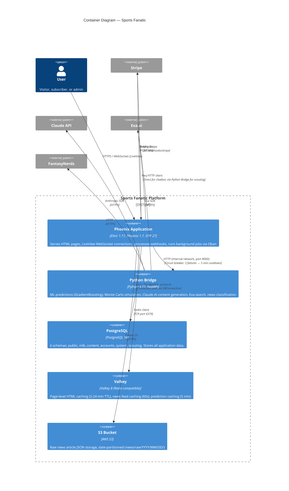

# C4 Model — Level 2: Container Diagram

## Container Details

### Phoenix Application (Elixir)
- **Runtime**: Erlang/OTP 27 release, Elixir 1.17
- **Web framework**: Phoenix 1.7.22, LiveView 0.19
- **Background jobs**: Oban 2.x (PostgreSQL-backed, 16 workers)
- **Key responsibilities**: HTML rendering, WebSocket connections, authentication, subscription gating, Oban job scheduling, PubSub broadcasting, agentic chatbot orchestration
- **Ports**: 4000 (HTTP)

### Python Bridge (FastAPI)
- **Runtime**: Python 3.11+, Uvicorn
- **ML models**: scikit-learn GradientBoosting (hit/HR prediction), NumPy Monte Carlo (10k trials)
- **AI integration**: Anthropic SDK (Claude Haiku for classification, Sonnet for reports), Exa SDK (scouting search)
- **Endpoints**: `/predict/*`, `/scouting/*`, `/gameday/*`, `/news/*`, `/agents/*`, `/chat/*`
- **Ports**: 8000 (internal only)

### PostgreSQL
- **Version**: 16-alpine
- **Schemas**: `public` (entities), `mlb` (game data), `content` (AI content + news), `accounts` (auth + chat + agents), `system` (operations), `scouting`
- **Key features**: Full-text search (tsvector on news_items), UUID primary keys, JSONB for flexible schemas

### Valkey
- **Version**: 8-alpine (Redis-compatible)
- **Pattern**: Read-through cache with proactive invalidation
- **TTL strategy**: 60s for feeds, 2-15 min for pages, 6h for sitemaps

### S3
- **Usage**: Raw news article JSON archival
- **Path pattern**: `news/raw/{YYYY}/{MM}/{DD}/{external_id}.json`
- **Access**: Application-layer only (bucket not public)
