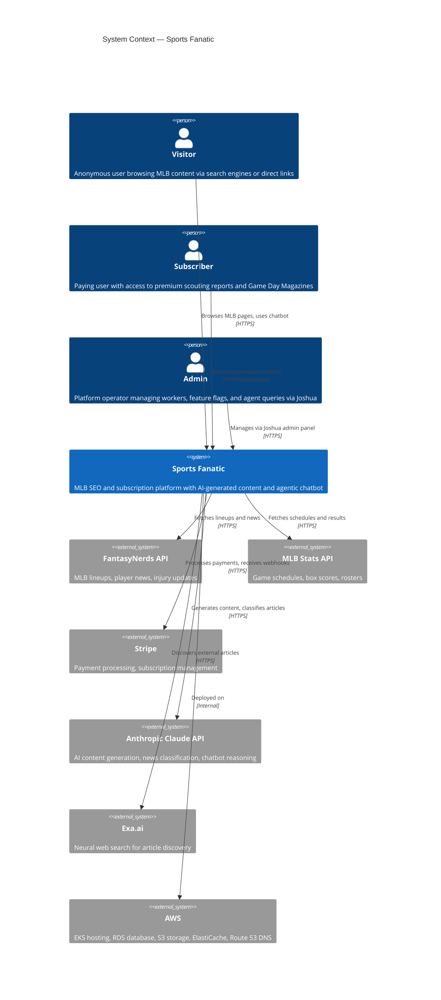

# C4 Model — Level 1: System Context

Sports Fanatic is an MLB platform serving two user populations through a single system.

## Actors

| Actor | Description |
|-------|-------------|
| Visitor | Anonymous user. Accesses all public SEO pages and the agentic chatbot. Arrives via Google or direct link. |
| Subscriber | Authenticated user with active Stripe subscription. Accesses premium scouting reports, Game Day Magazines, and live game dashboards. |
| Admin | Operator authenticated via Joshua gate (`/joshua`). Manages Oban workers, feature flags, agentic query clusters, and monitors the platform. |

## External Systems

| System | Integration | Frequency |
|--------|-------------|-----------|
| FantasyNerds | REST API for lineups (every 30 min) and news (every 1 min) | High |
| MLB Stats API | REST API for schedules, rosters, game results | Daily + event-driven |
| Stripe | Checkout sessions, webhooks for subscription lifecycle | On-demand |
| Anthropic Claude | Content generation (Haiku for classification, Sonnet for reports) | Per-article + daily |
| Exa.ai | Neural search for external article discovery via chatbot | Per user query |
| AWS | Full deployment target (EKS, RDS, ElastiCache, S3, Route 53) | Always |
