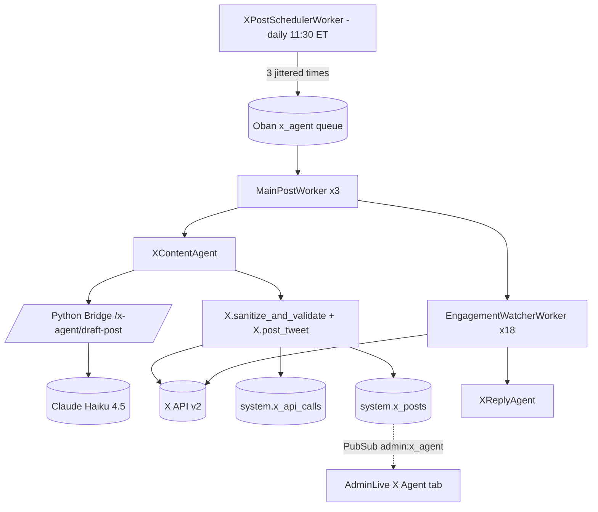

Parent: `../../../CLAUDE.md`

# CLAUDE.md — X (Twitter) Marketing Agent

> See the Documentation Placement Rule in `../../../CLAUDE.md` before adding
> content here.

---

The X Agent posts three daily marketing tweets and replies to inbound /
outbound activity. Single org account; gated by three feature flags.

## Feature flags

- `x_agent_enabled` (default `false`) — master switch. Every X worker exits
  early when off.
- `x_agent_approval_required` (default `true`) — first 14 days mode. When on,
  `MainPostWorker` composes the post body but parks it in `pending` state for
  admin approval before posting.
- `x_agent_outbound_replies_enabled` (default `false`) — additional gate on
  `OutboundReplyWorker` (replies to watched accounts).

## Architecture



## Module map

| Module | File | Purpose |
|--------|------|---------|
| `SportsFanatic.X` | `../x.ex` | OAuth, post_tweet/2 funnel, sanitizer, reads |
| `SportsFanatic.X.CircuitBreaker` | `circuit_breaker.ex` | 3 failures / 5 min cooldown (separate from python_bridge breaker) |
| `SportsFanatic.X.TokenVault` | `token_vault.ex` | AES-256-GCM via `:crypto`; reads key from env |
| `SportsFanatic.X.SpendLedger` | `spend_ledger.ex` | mills-based daily cap |
| `SportsFanatic.X.Scheduler` | `scheduler.ex` | Pure plan_day/1 (window + jitter) |
| `SportsFanatic.X.InjuryReport` | `injury_report.ex` | List + generate-or-fetch per player |
| `SportsFanatic.X.TeamMagazine` | `team_magazine.ex` | Generate-or-fetch + daily rotation team |
| `SportsFanatic.X.Credentials` | `credentials.ex` | Schema for `accounts.x_credentials` |
| `SportsFanatic.X.Post` | `post.ex` | Schema for `system.x_posts` |
| `SportsFanatic.X.WatchedTarget` | `watched_target.ex` | Schema for `accounts.x_watched_targets` |
| `SportsFanatic.X.ApiCall` | `api_call.ex` | Schema for `system.x_api_calls` |
| `SportsFanatic.X.PostRotation` | `post_rotation.ex` | Schema for `system.x_post_rotation` |
| Workers | `../workers/{x_post_scheduler,main_post,engagement_watcher,outbound_reply,weekly_scorecard,refresh_x_token}_worker.ex` | See `../workers/CLAUDE.md` |
| Agents | `../agents/x_content_agent.ex`, `../agents/x_reply_agent.ex` | See `../agents/CLAUDE.md` |

## Cost model (mills = 1/1000 of a dollar)

- 15 mills per pure-text write
- 200 mills per URL-bearing write (X's link tax)
- Daily cap default: 5000 mills ($5). Override with `X_DAILY_CAP_MILLS`.

`SpendLedger.budget_remaining?/0` is checked at the top of every
`X.post_tweet/2` call. On `false`, the call returns `{:error, :budget_exceeded}`
and broadcasts `{:budget_exceeded, today_mills}` on `"admin:x_agent"` once
per day.

## Sanitization

`X.sanitize_and_validate/1`:

1. Strips control chars except `\n` (`String.replace(body, ~r/[\x00-\x09\x0B-\x1F\x7F]/u, "")`)
2. NFC-normalizes (`:unicode.characters_to_nfc_binary/1`)
3. Enforces `String.length/1 <= 280`
4. `HtmlSanitizeEx.strip_tags/1` (defense in depth)
5. Rejects `http://` or `https://` substrings in main body unless caller passes
   `:allow_url, true` (the self-reply path)

Strings written to `content.injury_reports` and `content.team_magazines` are
sanitized via `HtmlSanitizeEx.strip_tags/1` before INSERT. `system.x_posts`
`main_body` / `reply_body` are not yet pre-sanitized at the storage boundary
(X-SEC-SANITIZE-1 in `docs/KNOWN_ISSUES.md`) — the XSS exit paths are protected
by HEEx auto-escape and the `sanitize_and_validate/1` pre-wire check. Templates
use `<%= ... %>` only — never `raw/1`. Acceptance criterion #9
(`git grep -n "raw(" lib/sports_fanatic_web/controllers/...`) enforces this.

## OAuth flow

PKCE OAuth 2.0, manual (no `assent` dep). Two endpoints:

- `GET /admin/x/oauth/start` — generates a 32-byte verifier + challenge,
  stores the verifier and a 32-byte state token in the session, redirects to
  X.
- `GET /admin/x/oauth/callback` — validates state, exchanges code for tokens,
  encrypts via `TokenVault`, upserts the singleton row in
  `accounts.x_credentials`, redirects to `/admin#x_agent`.

Both routes sit inside the existing `:require_joshua` pipeline.

`RefreshXTokenWorker` runs hourly, refreshes if `expires_at < now + 5 min`.

## Spend / audit (`system.x_api_calls.actor`)

- `"system"` — cron-triggered writes
- `"joshua:{timestamp}"` — admin-triggered (Post Now, Approve)
- `"watcher"` — replies driven by `EngagementWatcherWorker`

Free-text column, max 100 chars.

## Single-row credentials

`accounts.x_credentials` uses a `singleton :boolean default true NOT NULL`
column with a `UNIQUE` index. Exactly one row ever exists; OAuth upserts
overwrite the existing row.

The schema is `@derive {Inspect, except: [:access_token, :refresh_token,
:access_token_ciphertext, :refresh_token_ciphertext]}` so plaintext or
ciphertext tokens never leak through `inspect/1` or Phoenix error pages.

## Window + jitter

`Scheduler.plan_day(date)` is pure:

1. base window = 13:00 ET to 18:00 ET on `date`
2. earliest_game = `min(scheduled_games.game_datetime where game_date = date)`
3. hard_latest = `earliest_game - 30 min`, clamped to base upper bound
4. 3 slots with ≥45 min spacing
5. ±18 min uniform jitter per slot
6. drop slots that would land after `hard_latest`
7. randomize `[top_hits, injury, team_magazine]` order seeded by
   `Date.to_gregorian_days/1` so the order is reproducible same-day

## On-site pages

| URL | Owner |
|-----|-------|
| `/mlb/injury-report` | `InjuryReportController :index` |
| `/mlb/injury-report/:player_slug` | `InjuryReportController :show` (slug regex `^[a-z0-9-]{1,100}$`) |
| `/mlb/injury-report/og/:player_slug.png` | `InjuryReportController :og_image` (static placeholder) |
| `/mlb/teams/:team_slug#magazine` | Anchor inside `TeamController :show` |

Slug regex is checked **before** any DB lookup or `File.read/1`. Mismatch
returns 404 immediately.

## Open Graph image

Server-side composition (player photo + status badge) is deferred (X-AGENT-002
in `docs/KNOWN_ISSUES.md`). The og_image action serves
`priv/static/og/players/{sanitized_slug}.png` if it exists, else the generic
fallback `priv/static/og/injury-default.png`.

## Env vars

| Var | Default | Required when |
|-----|---------|---------------|
| `X_CLIENT_ID` | — | `x_agent_enabled=true` |
| `X_CLIENT_SECRET` | — | `x_agent_enabled=true` |
| `X_REDIRECT_URI` | `https://sportsfanatic.com/admin/x/oauth/callback` | When the X dev portal redirect URI differs |
| `X_TOKEN_ENCRYPTION_KEY` | — | always; 32 raw bytes, Base64-encoded |
| `X_DAILY_CAP_MILLS` | `5000` | optional override |
| `X_ACCOUNT_HANDLE` | `""` | optional display only |

## DST drift (X-AGENT-001)

All cron expressions are UTC. Schedule (`30 15 * * *`) = 11:30 ET during EDT;
during EST (Nov–early March) it would shift to 10:30 ET. Baseball season is
April–October so EDT applies almost always. No automatic DST handling.

## Operator runbook

### 1 — Apply for X API access (one-time)

1. Create an X account that will be the posting account. The profile bio must
   disclose that it is bot-assisted ("Posts may be generated by an automated
   system") per X Developer Policy.
2. Go to <https://developer.x.com/en/portal/dashboard> and create a new project
   with use-case "Automated content sharing."
3. Apply for **Free** tier access first; once approved, upgrade to **Basic**
   ($100/mo) if higher rate limits are needed. The free tier allows up to 1500
   tweets/month, which covers 3/day × 31 days = 93.
4. Enable **X Premium** on the posting account ($8/mo) if 10× organic reach is
   desired.
5. Set the app's OAuth 2.0 redirect URI in the X developer portal to match
   `X_REDIRECT_URI` (default: `https://sportsfanatic.com/admin/x/oauth/callback`).
6. Copy the **Client ID** and **Client Secret** (OAuth 2.0 app credentials) into
   `X_CLIENT_ID` and `X_CLIENT_SECRET` in `runtime.exs` / your secret manager.

**Approval timeline**: ~14 business days for initial Basic tier review. Plan for
roughly 15 minutes of back-and-forth per review cycle. Automated content use
cases are subject to a $50 minimum pre-payment before developer portal access
is enabled.

### 2 — Generate the token encryption key

```bash
# On any system with OpenSSL:
openssl rand -base64 32
# Copy the output → X_TOKEN_ENCRYPTION_KEY
```

The key must decode to exactly 32 bytes (256 bits). The `TokenVault` rejects
other lengths with `{:error, :invalid_key}`.

### 3 — Connect the X account via OAuth

1. Navigate to `/admin`, open the **X Agent** tab.
2. Click **Connect X Account** — this redirects to `GET /admin/x/oauth/start`
   which performs PKCE OAuth 2.0.
3. Authorize the app on X.com.
4. On callback, tokens are encrypted and stored as the singleton row in
   `accounts.x_credentials`.
5. `RefreshXTokenWorker` keeps the access token fresh automatically (hourly).

### 4 — Enable the agent in approval mode

1. Toggle `x_agent_enabled` on (AdminLive X Agent tab, or `FeatureFlags.update/2`
   in IEx). Leave `x_agent_approval_required` on.
2. `XPostSchedulerWorker` will compose posts and park them as `pending` each day.
3. Review the queue in AdminLive, then **Approve** or **Edit + Approve** each post.
4. After 14 days with no incidents, toggle `x_agent_approval_required` off for
   fully automated posting.

### 5 — Day-to-day operations

- **Pause for the day**: toggle `x_agent_enabled` off. In-flight Oban jobs
  return `{:ok, :disabled}` without posting.
- **Post Now (out-of-cycle)**: use the AdminLive X Agent tab "Post Now" button.
  Rate-limited to 1/min via `:x_admin_rate_limit` ETS table.
- **Reschedule today's window**: click "Reschedule Day" (rate-limited 1/5 min).
- **Budget exceeded**: the `"admin:x_agent"` PubSub broadcasts
  `{:budget_exceeded, today_mills}` which surfaces in AdminLive. Increase
  `X_DAILY_CAP_MILLS` or wait until tomorrow's reset.
- **Rotate `X_TOKEN_ENCRYPTION_KEY`**: (1) decrypt all existing tokens using
  the old key, (2) re-encrypt with the new key, (3) update the env var, (4)
  restart the app. There is no automated key-rotation helper yet — do this
  manually in IEx via `TokenVault.decrypt/2` + `TokenVault.encrypt/1`.

### 6 — DST note

Cron expressions are UTC. `XPostSchedulerWorker` runs at `30 15 * * *` (UTC),
which is 11:30 AM ET during EDT. During EST (approximately November–early
March) this shifts to 10:30 AM ET. Baseball season is April–October so EDT
applies for nearly all game days. See X-AGENT-001 in `docs/KNOWN_ISSUES.md`.
